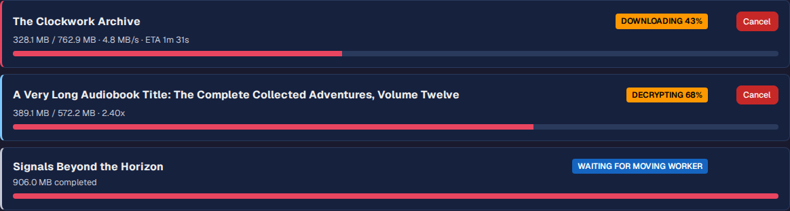
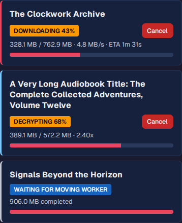

# Queue and Download Books

Use this page to manage processing from queue to finished media.

## Queue Books

From Library or Dashboard:

- Queue single book
- Queue all new books

## Pipeline Stages

Each book moves through:

1. Downloading
2. Decrypting
3. Processing/Organizing
4. Destination fan-out (for enabled destinations)

Example using synthetic book data. Stage labels and colored card edges distinguish active work; each card shows its own progress and available actions.

Mobile layout:

## Dashboard Completions

The dashboard defaults to the last seven days and lists the ten newest
completions in that window. Choose 24 hours, seven days, 30 days, or all time.
The matching total includes entries beyond the ten shown; **View history** opens
the full Pipeline history for the selected window.

Older entries leave the dashboard as they age out of the selected window, but
remain in download history. Automatic dashboard refreshes preserve your selection.

## Pause, Resume, Cancel, Retry

Available actions:

- Pause downloads
- Resume downloads
- Cancel queued/active items
- Retry failed items

## Reorganize and Redownload

- Reorganize: re-run organization for existing media.
- Redownload: fetch source again for a specific ASIN when needed.

## Common Expectations

- A finished raw download is not final completion; decrypt/process still run.
- If one destination fails, other destinations can still complete.
- Progress is visible in Downloads and Dashboard panels.
